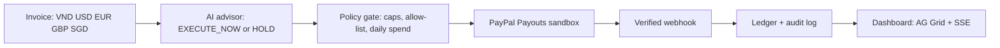

<div align="center">

# 🛡️ BAO VE TIEN

### *An AI FX advisor that decides when to pay, and pays through PayPal Payouts.*

**Autonomous Global Treasury · PayPal AI Hackathon 2026**

<br />

[](https://paypalaihackathon.devpost.com/)
[](https://github.com/Olympusxvn/BAO-VE-TIEN)

<br />

[](https://github.com/Olympusxvn/BAO-VE-TIEN)
[](#-for-judges--5-min-verify)
[](docs/project_overview.md)

<br />

[](https://www.typescriptlang.org/)
[](https://nodejs.org/)
[](https://react.dev/)
[](LICENSE)

<br />

> **New here?** Start at [For judges](#-for-judges--5-min-verify) — the whole verify path takes about 5 minutes.

<br />

```
Invoice (VND / USD / EUR / GBP / SGD)
    → AI advisor: EXECUTE_NOW or HOLD
    → Policy gate: caps · allow-list · daily spend
    → PayPal Payouts (sandbox) → verified webhook
    → Ledger + audit log (AG Grid dashboard, live via SSE)
```

</div>

---

## 📑 Contents

| | |
|:---|:---|
| ⚖️ | [For judges — 5 min verify](#-for-judges--5-min-verify) |
| 🏗️ | [Overview](#-overview) |
| ⚡ | [Quick start](#-quick-start) |
| 📊 | [Measured numbers](#-measured-numbers) |
| 🛡️ | [Approval modes](#-approval-modes) |
| 🤖 | [AI providers](#-ai-providers) |
| 🔒 | [Safety](#-safety) |
| 📚 | [Documentation](#-documentation) |
| ✅ | [Submission checklist](#-submission-checklist) |

---

<div align="center">

## ⚖️ For judges — 5 min verify

**No secrets in this repo. You bring your own PayPal sandbox credentials and (optionally) an AI key.**

</div>

```bash
git clone https://github.com/Olympusxvn/BAO-VE-TIEN.git
cd BAO-VE-TIEN
npm install
cp .env.example .env   # fill in PAYPAL_SANDBOX_CLIENT_ID / PAYPAL_SANDBOX_CLIENT_SECRET / PAYPAL_WEBHOOK_ID
npm run build
npm test               # 35 pass / 0 fail / 3 skipped
npm start              # http://localhost:3000 — dashboard + API (sandbox only)
```

Prove Payouts with one command (needs `.env` above):

```bash
node scripts/sandbox-payout-201.mjs   # HTTP 201 + payout_batch_id on success
```

Success is HTTP 201 with a `payout_batch_id`. A 403 means Payouts is not
enabled for the sandbox app; a 401 means the sandbox credentials in
`.env` are wrong. A sandbox 201 proves sandbox Payouts works; it does
not prove live Payouts approval. Sandbox state can reset — if the smoke
test returns 403, Payouts was disabled by the reset; the Nov 7, 2026
201 below (`payout_batch_id` SZVFXWTEXSY9W) is the dated evidence.

| 🔗 Resource | 📍 Link |
|:------------|:--------|
| **🎬 Demo video** | < 3 min, public on YouTube — linked in the Devpost submission |
| **📖 Demo script** | [docs/DEMO-SCRIPT.md](docs/DEMO-SCRIPT.md) |
| **🔍 Audit report** | [AUDIT-2026-11-06.md](AUDIT-2026-11-06.md) |
| **🏗️ Technical spec** | [docs/technical_specification.md](docs/technical_specification.md) |
| **📜 Rules** | [docs/RULE.md](docs/RULE.md) |

---

## 🏗️ Overview

BAO VE TIEN is an autonomous global treasury for digital businesses that
pay vendors across borders. Invoices arrive in VND, USD, EUR, GBP or
SGD; the AI advisor reads the FX context and recommends `EXECUTE_NOW`
or `HOLD`; a pre-approved policy (caps, allow-list, daily spend)
decides whether money moves; PayPal Payouts executes; verified
webhooks update the ledger live.

In **Human mode** (default) a person approves every batch. In **Auto
mode** (opt-in) the AI executes qualifying batches by itself — inside
the policy, with warnings, a pause switch, and a full audit log.

Payouts are USD, EUR, GBP, SGD only. A VND invoice is displayed in VND
and converted to USD at the Frankfurter (ECB) rate before the PayPal
call; VND is never sent as a payout currency.

| Layer | Responsibility |
|:------|:---------------|
| **🖥️ Experience** | React 19 dashboard, AG Grid Community ledger, live updates via SSE |
| **🤖 Advisor** | OpenAI (default) or Gemini, rule-based HOLD fallback, judge BYOK |
| **🛡️ Policy** | PayoutGuard: per-item / per-batch / daily caps, allow-list (max 20), FX risk |
| **💸 Execution** | PayPal Payouts REST API (sandbox only), signature-verified webhooks |
| **📒 Ledger** | In-memory store (demo only), audit log, SSE events |



---

## ⚡ Quick start

```bash
npm install
cp .env.example .env   # fill in sandbox credentials (see table below)
npm run build
cd frontend && npm install && npm run build && cd ..   # dashboard UI
npm start              # http://localhost:3000 (sandbox only)
npm test               # 35 pass / 0 fail / 3 skipped
```

| Variable | Purpose |
|:---------|:--------|
| `PAYPAL_SANDBOX_CLIENT_ID` / `PAYPAL_SANDBOX_CLIENT_SECRET` | Sandbox REST app credentials |
| `PAYPAL_WEBHOOK_ID` | Webhook signature verification — without it, every webhook is rejected |
| `AI_PROVIDER` | `openai` (default) or `gemini` |
| `OPENAI_API_KEY` / `OPENAI_MODEL` | OpenAI advisor (default model `gpt-4o`) |
| `GEMINI_API_KEY` / `GEMINI_MODEL` | Gemini advisor (default model `gemini-2.5-flash`) |
| `PORT` | Server port (default `3000`) |

| Route | What it does |
|:------|:-------------|
| `POST /api/treasury/batches` | Create a DRAFT batch |
| `GET /api/treasury/batches[/:id]` | List / read batches |
| `POST /api/treasury/batches/:id/advise` | AI advisor: stores recommendation + FX risk score; never approves or executes |
| `POST /api/treasury/batches/:id/approve` | Human approval gate: re-checks policy, then executes |
| `GET` / `POST` / `DELETE /api/treasury/allowlist` | Recipient allow-list (max 20, demo only, no auth) |
| `GET` / `POST /api/treasury/mode`, `POST /api/treasury/mode/pause` | Human/Auto mode + kill switch |
| `GET /api/treasury/audit` | Audit log |
| `GET /api/treasury/events` | SSE payout updates |
| `POST /api/webhooks/paypal` | Signature-verified PayPal webhook |
| `GET /api/health` | Health check |

No route executes an unauthorized batch. Batches, the allow-list and
daily spend are in-memory (demo only).

---

## 📊 Measured numbers

Only these numbers are stated as results here. The full table, the
method, and the numbers still to measure live are in
[docs/DEMO-SCRIPT.md](docs/DEMO-SCRIPT.md).

- Backend tests: 35 pass / 0 fail / 3 skipped, ~2.6 s (`npm test`,
  2026-11-10; the 3 skipped tests need live credentials and are never
  faked).
- Frontend build: clean, ~6 s (AG Grid chunk-size warning only).
- Local API round-trips (no credentials, 2026-11-07): health ~0.01 s,
  create batch ~0.01 s (201 DRAFT), rule-based advise ~1.36 s (includes
  the Frankfurter FX fetch), approve to a clear 502 refusal ~0.004 s.
- Sandbox Payouts: HTTP 201, `payout_batch_id` SZVFXWTEXSY9W,
  `batch_status` PENDING, $1.00 USD — run on the demo machine,
  2026-11-07. A sandbox 201 proves sandbox Payouts works; it does not
  prove live Payouts approval.
- Frankfurter FX (rates dated 2026-11-05): EUR 0.89095, GBP 0.74299,
  SGD 1.2773 per USD.

Still to measure live: payout round-trip, webhook-to-UI time, live
advise time + the model actually used.

No FX-savings percentage, payout-latency figure, or FPS number is
claimed anywhere in this repo until it is measured live.

---

## 🛡️ Approval modes

Two treasury-level modes, default **Human**. Human mode: every batch
needs a human Approve click; no auto-execution path. Auto mode
(opt-in): a batch executes automatically only when it passes the
policy, the tighter auto caps, an `EXECUTE_NOW` recommendation and a
low FX risk score — otherwise it stays `AWAITING_APPROVAL`. Auto
execution uses the same `executeBatchPayout` path with the policy
re-checked; a manual Approve click still works in Auto mode.

| Cap | Human (manual approve) | Auto (automatic) |
| --- | --- | --- |
| Per-item | $250 | $100 |
| Per-batch | $500 | $250 |
| Daily | $1,000 | $500 (auto-spent-today budget) |
| FX risk score | no limit | < 3.0 |
| Advisor | EXECUTE_NOW required | EXECUTE_NOW required |

Mode endpoints: `GET /api/treasury/mode`, `POST /api/treasury/mode
{ mode: 'HUMAN' | 'AUTO' }`, `POST /api/treasury/mode/pause
{ paused: boolean }` (kill switch — pausing stops all auto-execution
immediately), `GET /api/treasury/audit` (mode changes, pause changes,
auto executions with policy snapshot + advisor output, blocked
evaluations).

Warnings (exact copy, also in `frontend/src/modeStrings.ts`): enabling
Auto shows a confirm dialog — "Auto mode executes batches
automatically when they pass policy — no per-batch approval. Waiting
for approval can mean missing an FX window. Only enable Auto mode if
you trust the policy, caps, and allow-list. You can pause it anytime."
— and there is no UI path to Auto mode that skips it. While Auto is
on, an always-on banner reads "Auto mode is ON — qualifying batches
execute automatically. Pause anytime.", the header shows an amber Auto
badge, and every auto-executed batch carries the notice "Executed
automatically in Auto mode — policy + advisor output logged".

Why Auto exists: waiting for human approval can mean missing the FX
window — enable Auto only if confident in the policy. That is also
what makes the entry truly agentic: in Auto mode the AI decides and
acts within a pre-approved policy, not just recommends. The demo video
features Auto executing a real sandbox batch.

---

## 🤖 AI providers

Two providers behind one advisor interface. OpenAI is the default
(model `gpt-4o` via `OPENAI_MODEL`, key `OPENAI_API_KEY`). Gemini is
the second provider (model `gemini-2.5-flash` via `GEMINI_MODEL`, key
`GEMINI_API_KEY`, endpoint `generativelanguage.googleapis.com`, key sent
in the `x-goog-api-key` header, never in the URL). Select with
`AI_PROVIDER=openai|gemini` (default `openai`).

A judge can bring their own key at runtime, from the dashboard's
"Advisor provider" panel or `POST /api/treasury/advisor/config`
`{ provider, apiKey?, model? }`: the key lives in memory for this
session only — it is never saved, logged, or returned
(`GET /api/treasury/advisor/config` returns `{ provider, model, keySet }`);
`DELETE /api/treasury/advisor/config` clears it and falls back to env.
The advise response's `model` always names the provider and model
actually used (`openai/gpt-4o`, `gemini/gemini-2.5-flash`).

Free-tier caveat: Gemini free-tier content may be used to improve
Google's products, so the PII mask applies before any LLM call on
either provider — raw recipient emails are never sent to an LLM.

---

## 🔒 Safety

- Sandbox only: no live PayPal URL anywhere in the code.
- No credential is printed by any script, and `.env` is gitignored.
- No payout is sent without authorization: in Human mode without a
  human approval, in Auto mode without passing the policy + auto caps
  + EXECUTE_NOW + low FX risk. Over-cap or off-list batches stay
  `AWAITING_APPROVAL` and are never sent.
- Webhooks use the real PayPal event names
  (`PAYMENT.PAYOUTSBATCH.*` / `PAYMENT.PAYOUTS-ITEM.*`) with
  signature verification; unverified events are rejected and never
  update the ledger.
- PII masking is deterministic (emails keep the first 2 characters of
  the local part + domain, free text becomes `[REDACTED]`).
- APIMatic is build-time only (see [docs/APIMATIC.md](docs/APIMATIC.md));
  the payout guard is the project's own code. AG Grid is Community
  (MIT) v36.x — no Enterprise, no licence key.

---

## 📚 Documentation

| 📄 Document | 🎯 Purpose |
|:------------|:-----------|
| [docs/project_overview.md](docs/project_overview.md) | What it is, who it is for |
| [docs/product_requirements_document.md](docs/product_requirements_document.md) | Requirements + NFR targets |
| [docs/technical_specification.md](docs/technical_specification.md) | Architecture, API, webhook, safety |
| [docs/strategy_roadmap.md](docs/strategy_roadmap.md) | Hackathon fit + plan |
| [docs/RULE.md](docs/RULE.md) | Hard constraints (currencies, caps, secrets) |
| [docs/APIMATIC.md](docs/APIMATIC.md) | APIMatic: build-time only, honest scope |
| [docs/GEMINI-RESEARCH.md](docs/GEMINI-RESEARCH.md) | Gemini provider research |
| [docs/DEMO-SCRIPT.md](docs/DEMO-SCRIPT.md) | Demo script + measured numbers table |
| [AUDIT-2026-11-06.md](AUDIT-2026-11-06.md) | Audit report (conditional go) + fix log |

---

<details>
<summary><strong>🔗 References</strong></summary>

| Resource | Link |
|:---------|:-----|
| PayPal AI Hackathon (Devpost) | https://paypalaihackathon.devpost.com/ |
| PayPal Payouts API docs | https://developer.paypal.com/api/payouts |
| Payouts API reference | https://developer.paypal.com/api/payments.payouts-batch/v1 |
| Frankfurter API (ECB reference rates) | https://api.frankfurter.dev/v1/latest |

</details>

---

## ✅ Submission checklist

- [x] Working demo (sandbox) + demo video < 3 min, public on YouTube — submitted to Devpost Nov 10, 2026
- [x] Meaningful use of PayPal (Payouts API, sandbox) + AI (OpenAI / Gemini advisor)
- [x] Public repo with MIT license — repo flips public Nov 12, 2026
- [x] README run instructions (this file)
- [x] AI tools statement: OpenAI GPT-4o (default) + Gemini (judge BYOK)

---

<div align="center">

**BAO VE TIEN**

*An AI FX advisor that decides when to pay, and pays through PayPal Payouts.*

[](https://github.com/Olympusxvn/BAO-VE-TIEN/stargazers)

Built for the PayPal AI Hackathon 2026 · MIT License

</div>
